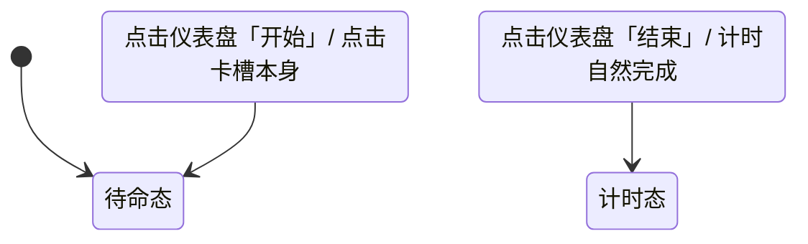

# spec-agy-slot-261012 · 打卡机卡槽重做规格（静态拟物 · 零插入动画）

> **文档归属**：Sprint 26100301 (practice 页右栏重构) ｜ 交付物 A  
> **上游 MRD**：`tqob/05-Coding/project-dizical/PRDs/MRD-左右栏组合问题.md`（标题 `## 2610120839-demo v3.2` 第 1 条）  
> **参考图基线**：`docs/demos/practice-right-column-261003/参考图文字基线-261012.md`（dad image21 逐图读数反面教材）  
> **任务 Brief**：`docs/demos/practice-right-column-261003/brief-agy-combos-261012.md` §A  
> **设计责任人**：agy ｜ 状态：正式设计规格（已按参考图基线校正）

---

## 1. 背景与核心设计裁决

### 1.1 Dad MRD 第 1 条原文
> “看截图，你管这个叫做好了？我跟没看出来这是什么卡槽 就是一个个框框，你在做什么？卡槽插入的动画全部不要了”

### 1.2 核心问题归因
在旧版 `canvas-01.html` 中（参考图 image21 现场抓包所证），卡槽被做成了极其突兀粗糙的结构：
1. **外挂红框与文字按钮**：包含醒目的红框按键「插入票卡 · 点亮仪表盘」及分离的「卡槽」「待命入槽」；
2. **悬空小方框**：浮动着一个被 dad 直斥为“一个个框框”的 `.cz-mini` 浮动框；
3. **时钟竞态泥潭**：为了模拟卡片掉入框框，引入了 WAAPI 补间动画，导致无头环境与主线程抖动下频发 `onfinish` 与 `fallback` 抢跑冲突；
4. **层级混乱**：浮层打开时，这套粗糙的红框与文字依然顽固透出在界面中。

### 1.3 核心设计裁决
1. **彻底删除插入动画**：**100% 静态展示**，严禁使用任何 `animate()`、CSS keyframes 动画或 JS 过渡补间；
2. **彻底消灭外挂红框按钮与悬空小框**：不再设置任何独立的“插入票卡按钮”；
3. **回归真实打卡机卡槽（Punch Card Slot）拟物原型**：重现经典考勤打卡机/艺术票务验票机顶部**凹陷进纸口（Inset Slot Mouth）**与**导卡托唇（Slot Lip）**的工业设计；
4. **两态静态差异（原子切换）**：
   - **待命态**：呈现为一个精致、空置、向内凹陷的物理狭缝，带有微型状态压印文案；
   - **计时态**：呈现为票卡已被物理咬合、牢固深插在狭缝中的**静态卡头露出（Card Head Exposed）**质感；
   - 两态切换仅通过 DOM class / data-attribute 瞬时切换，零时钟风险。

---

## 2. 卡槽几何与材质规格（CSS / 尺寸）

卡槽作为一个独立的物理构件（组件名：`.cz-punch-slot`），其外观设计为真实工业机械的金属/工程塑料压铸狭缝。

```
┌──────────────────────────────────────────────────────────────┐
│  .cz-slot-chassis (卡槽基座外框 宽100% / 高48px / 凸面微光)   │
│   ┌──────────────────────────────────────────────────────┐   │
│   │ ░░░ 导卡托盘（斜向内缩导角 Card Guide Bevel） ░░░░░░░ │   │
│   │ ┌──────────────────────────────────────────────────┐ │   │
│   │ │ █ 物理深凹狭缝 (Slot Recess 高12px / 深度阴影) █ │ │   │
│   │ └──────────────────────────────────────────────────┘ │   │
│   └──────────────────────────────────────────────────────┘   │
└──────────────────────────────────────────────────────────────┘
```

### 2.1 几何参数定义

| 构件层级 | CSS 类名 | 宽度 | 高度 | 圆角 | 材质与色彩 (Token) | 阴影与深度 |
|---|---|---|---|---|---|---|
| **卡槽外框基座** | `.cz-slot-chassis` | 100% (自适应模块宽) | `48px` | `14px` | `var(--dash-surface-2)` (浅银 `#F4EFEB` / 深墨 `#3E474E`) | `inset 0 1px 0 var(--dash-key-hi)`, `0 4px 12px var(--dash-shell-shadow)` |
| **导卡托台** | `.cz-slot-guide` | `calc(100% - 16px)` | `32px` | `10px` | `var(--dash-shell-lo)` (略带微凹的磨砂金属台) | `inset 0 1.5px 2px var(--dash-shell-inset)` |
| **物理进卡狭缝** | `.cz-slot-mouth` | `calc(100% - 32px)` | `12px` | `4px` | 极深暗色 `#101316` (深邃进纸腔体) | `inset 0 4px 6px rgba(0,0,0,0.65)`, `0 1px 0 var(--dash-glint)` |

### 2.2 拟物内凹与光影代码实现
```css
/* 卡槽外框基座：凸起于背景，带有模具压铸边缘 */
.cz-punch-slot {
  width: 100%;
  box-sizing: border-box;
  padding: 6px 12px;
  background: linear-gradient(180deg, var(--dash-shell-hi) 0%, var(--dash-shell-lo) 100%);
  border: 1px solid var(--dash-ink-a12);
  border-radius: 16px;
  box-shadow: 
    0 4px 14px var(--dash-shell-shadow),
    inset 0 1px 0.5px rgba(255, 255, 255, 0.85);
  display: flex;
  align-items: center;
  justify-content: space-between;
  gap: 12px;
  user-select: none;
}

/* 槽口中轴区域：物理深陷进纸口 */
.cz-slot-mouth-wrap {
  flex: 1 1 auto;
  min-width: 0;
  height: 32px;
  background: var(--dash-surface-3);
  border-radius: 10px;
  padding: 0 10px;
  display: flex;
  align-items: center;
  box-shadow: inset 0 2px 4px rgba(44, 62, 80, 0.22);
  position: relative;
}

/* 进卡缝隙：深渊黑腔 */
.cz-slot-cavity {
  width: 100%;
  height: 12px;
  background: #0E1114;
  border-radius: 4px;
  box-shadow: inset 0 3px 5px rgba(0, 0, 0, 0.8);
  position: relative;
  overflow: hidden;
}
```

---

## 3. 两态静态差异规格（待命态 vs 计时态）

**严禁编写动画**。卡槽仅有两套并存的静态视觉状态，由父容器的 `data-mode="prep"` 或 `data-mode="run"` 纯 CSS 切换显隐。

### 3.1 待命态（Prep / Idle State）

* **形态语义**：打卡机已接通电源，卡槽空置，等待票卡插入。
* **DOM 结构**：
  ```html
  <div class="cz-slot-state-idle">
    <div class="cz-slot-cavity">
      <div class="cz-slot-aim-line"></div>
    </div>
    <div class="cz-slot-status-label">
      <span class="cz-slot-led-dot idle"></span>
      <span class="cz-slot-text">打卡机卡槽 · 待插卡</span>
    </div>
  </div>
  ```
* **视觉细节**：
  - 槽腔内部呈漆黑深陷状，中央有一道淡淡的橙色微弱荧光标线（宽度 24px，高度 2px，颜色 `var(--dash-vermilion-wash)`），指引插入对齐位置；
  - 槽右侧配有一颗直径 6px 的待命指示灯（淡灰微弱常亮，无呼吸无闪烁）及文字“待插卡”；
  - 彻底删除任何突兀的红框“插入票卡”按钮与悬空方框。

### 3.2 计时态（Running / Engaged State）

* **形态语义**：票卡已被打卡机机构牢固咬合，卡身深入机器内部，**仅露出票卡顶部头部（Card Head）约 26px**。
* **DOM 结构**：
  ```html
  <div class="cz-slot-state-engaged">
    <div class="cz-inserted-head">
      <div class="cz-head-notch"></div> <!-- 左侧单字冲压打孔 (Punch Hole 8px) -->
      <div class="cz-head-title">吸气长音</div> <!-- 本次练习科目名称 -->
      <div class="cz-head-badge">已检票打卡</div>
      <div class="cz-head-lip-shadow"></div> <!-- 卡身进入狭缝处的咬合投影 -->
    </div>
  </div>
  ```
* **视觉细节**：
  - **纸质真卡露头**：露出的卡头采用与左栏票卡 1:1 一致的米色纸质基底（`#FFF8F0`），带有 1px 极细边缘（`rgba(44, 62, 80, 0.15)`）；
  - **机械冲孔（Punch Hole）**：卡头左侧露出一个清晰的冲压孔（直通狭缝暗底），象征该票卡已被打卡机完成物理检票（Punch Validated）；
  - **咬合阴影（Lip Shadow）**：在卡头底边与槽口相交处，绘制 `box-shadow: inset 0 -3px 3px rgba(0,0,0,0.3)`，营造出卡片实实在在插入金属缝隙底部的纵深感；
  - **静态指示灯**：右侧状态灯瞬时变为常亮翠绿色（`#34D399`），状态字显示“已就绪 / 练习中”。

---

## 4. 与仪表盘的层级与布局位置

### 4.1 挂载位置方案：吸顶一体化（Chassis Top Integration）
卡槽在物理隐喻上是整个右栏仪表设备的**进纸顶冠（Top Crown）**：
1. **相对位置**：卡槽固定位于仪表盘（Card A）的**正上方**；
2. **边缘接缝处理**：
   - 卡槽底边与仪表盘顶边保持 **6px** 的紧密工业接缝距离；
   - 宽度与仪表盘的有效外框宽度严格 **100% 等宽对齐**；
3. **层级安全隔离 (Z-index)**：
   - 卡槽处于常规内容层（`z-index: 2`）；
   - 当发生全局弹窗（如曲目票夹选择、今日记录明细 Popout）时，卡槽绝对处于全局遮罩（`z-index: 10000`）之下，绝不得在弹窗上层露头。

---

## 5. 交互触发模型（点击谁触发）

由于彻底摒弃了独立的动画按钮与拖拽流程，卡槽的状态流转与整个页面的核心业务动作完全绑定：



1. **通道一（核心主链路）**：
   - 用户在准备态点击仪表盘主控按钮「开始练习」（即 Card A 药丸中的 `#btnPrimary`）；
   - 页面状态机由 `prep` 切换为 `run`，卡槽**同步、瞬时**呈现为「已咬合插入」态；
2. **通道二（卡槽直接点击兜底）**：
   - 卡槽外框支持光标点击（`cursor: pointer`，包含微弱 hover 描边提亮）；
   - 在准备态直接点击卡槽，等同于点击「检票入槽」，立即向主状态机分发开始信号；
3. **复位通道**：
   - 用户点击仪表盘「结束」或打卡完成，卡槽恢复待命狭缝态。

---

## 6. 验收与实测断言标准

1. **零动画断言**：
   - 在任何状态切换前后，卡槽内部元素 `getAnimations().length === 0`；
   - 无任何 `requestAnimationFrame` 驱动的位移或定时器；
2. **DOM 结构断言**：
   - 卡槽内不得存在旧版的 `.cz-mini` 浮动框、红框按键与 `.cz-slot` 框；
   - 必须包含 `.cz-slot-cavity`（狭缝腔体）与 `.cz-inserted-head`（卡头）；
3. **两态显隐断言**：
   - `data-mode="prep"` 下，`.cz-inserted-head` 的 `display === 'none'`，槽口为空；
   - `data-mode="run"` 下，`.cz-inserted-head` 可见，露头高度在 `24px ~ 28px` 之间，卡头包含科目名称。

---

## 7. 按参考图基线校正（image21 现场反面教材与卡槽去线框化校对）

根据 `docs/demos/practice-right-column-261003/参考图文字基线-261012.md` 中关于 dad image21 的现场读数，本规格进行了针锋相对的修正：

1. **指认并清除 image21 中的现场“劣质框框”**：
   - *image21 读数证实*：截图中左上角暴露着粗糙的红框「插入票卡·点亮仪表盘」以及「吸气长音 票卡缩略」两个独立的圆角线框。这正是 dad 愤怒批评“我根本没看出来这是什么卡槽 就是一个个框框”的直接来源；
   - *校正规约*：**全数删除该独立红框按钮与浮动缩略框**！卡槽彻底改为一体化内凹进纸狭缝（`.cz-slot-cavity`），以纯粹的机械冲压槽造型替代所有 UI 按钮框，彻底终结“一个个框框”的非专业观感。
2. **根治卡槽元素在弹窗下的越权穿透问题**：
   - *image21 读数证实*：当用户在左栏点击唤起「曲目票夹选择」弹窗时，由于缺乏严格的层叠隔离，这套卡槽红框直接透在半透明弹窗的背后，严重破坏了弹窗的视线聚焦；
   - *校正规约*：卡槽的层级明确锁定在 `z-index: 2`（与仪表盘主体机身同层），严格置于所有遮罩层（`z-index: 10000`）之下；弹窗打开时，卡槽作为底层机身安静隐于暗色高斯模糊之后，严禁任何高亮元素穿透浮层。
